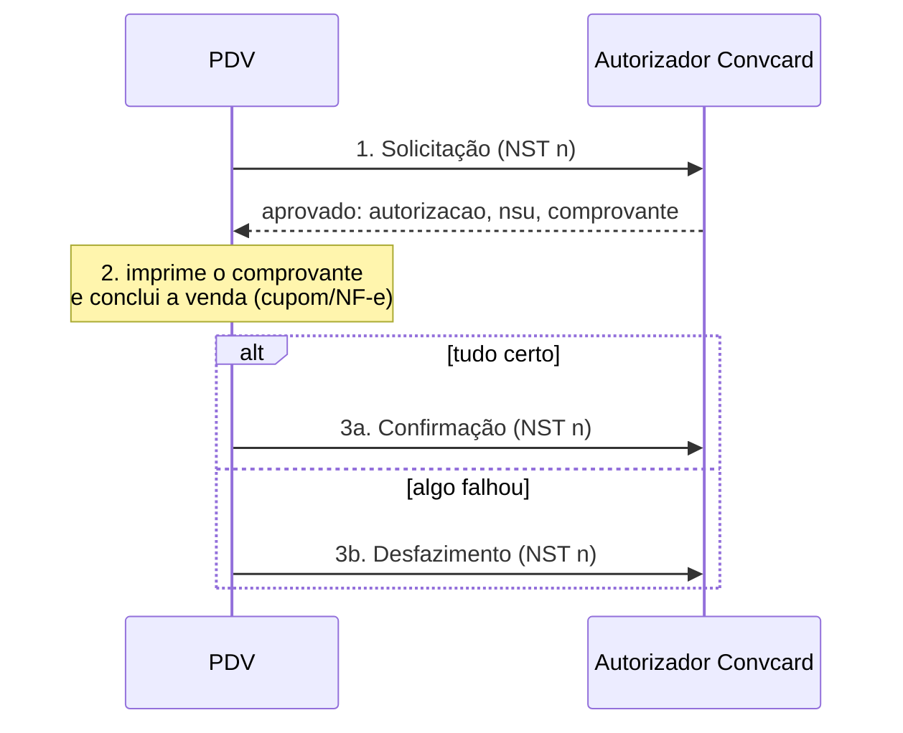

# 01 - Visão geral

Conceitos que valem para todos os processos da integração.

## Ambientes

| Ambiente | URL base | Credencial |
| --- | --- | --- |
| Homologação | `https://aut-h.convcard.com.br/autorizador` | Solicitada à equipe Convcard para iniciar o desenvolvimento |
| Produção | `https://aut.convcard.com/autorizador` | Enviada pela Convcard somente após a homologação ser aprovada |

Todos os caminhos desta documentação são relativos à URL base, por exemplo
`POST https://aut-h.convcard.com.br/autorizador/compra/solicitacao`.

O PDV de exemplo usa somente homologação (URL fixa em
`src/electron/convcard/cliente.ts`).

## Autenticação

A autenticação usa duas credenciais fornecidas pela Convcard:

| Credencial | Onde vai | Para quê |
| --- | --- | --- |
| **Certificado digital** (`.p12` / PKCS#12 + senha) | No handshake TLS (certificado de cliente, mTLS) | Identifica o integrador. Não existe header `Authorization` |
| **Token da loja** | Campo `identificadorLoja` do corpo de toda requisição | Identifica a loja (UUID, ex.: `01c760b2-a9db-429c-ad60-d926f49878cd`) |

Detalhes e exemplos de código em [02 - Configuração e validação](02-configuracao-e-validacao.md).

## Formato das requisições

- Corpo e resposta em **JSON** (`Content-Type: application/json` e `Accept: application/json`).
- Os métodos `PUT` e `DELETE` **também levam corpo JSON**. Garanta que o seu cliente HTTP envie o corpo nesses métodos (alguns clientes descartam o corpo em `DELETE`).
- Sucesso: HTTP **200**. Confirmações e desfazimentos respondem **200 sem corpo**.
- Erro: HTTP 4xx/5xx com o corpo no formato `Error` (ver [14 - Tratamento de erros](14-tratamento-de-erros.md)).
- Datas em ISO 8601 com fuso (`2023-12-29T09:27:48.50657021-03:00`).
- Valores monetários como número decimal (`1.5` = R$ 1,50).

## Campos base (presentes em toda requisição)

| Campo | Tipo | Descrição |
| --- | --- | --- |
| `nst` | inteiro (1 a 9999999999) | Número Sequencial da Transação, gerado pelo PDV (ver abaixo) |
| `nomeSoftware` | texto | Nome do seu software de PDV |
| `versaoSoftware` | texto | Versão do seu software de PDV |
| `identificadorLoja` | texto | Token da loja fornecido pela Convcard |

## NST - Número Sequencial da Transação

- Gerado pelo PDV, de **1 a 9999999999**. Ao chegar no máximo, volte para 1.
- Cada **nova operação** (compra, cancelamento, consulta, recebimento...) usa um NST novo.
- O **mesmo NST** deve ser usado em todas as etapas da mesma operação, como diz o swagger: *"Este número deve permanecer o mesmo durante todo o processamento da operação em tratamento, mesmo que envolva mais de um fluxo de mensagens"*.

| Operação | Etapas que usam o mesmo NST |
| --- | --- |
| Compra com cartão | solicitação → confirmação **ou** desfazimento |
| Compra com QR Code | gerar QR Code → todas as chamadas do pooling → confirmação **ou** desfazimento |
| Cancelamento | solicitação → confirmação **ou** desfazimento |
| Recebimento | solicitação → confirmação |

Persista o contador (banco local, por exemplo) para não repetir NST depois de
reiniciar o PDV. No exemplo: `proximoNst()` em `src/electron/armazenamento.ts`
(tabela SQLite `sequencia_nst`, incremento atômico numa única instrução SQL).

## Modelo de duas etapas (solicitação + confirmação)

Compras, cancelamentos e recebimentos seguem o modelo TEF de duas etapas:

1. **Solicitação**: o autorizador aprova (ou recusa) e devolve `autorizacao`, `nsu` e `comprovante`.
2. O PDV conclui a operação do lado dele: imprime o comprovante, emite o documento fiscal, grava a venda.
3. O PDV **confirma** (efetiva) ou **desfaz** (estorna) a transação.

Uma transação aprovada **nunca** pode ficar sem confirmação ou desfazimento.
Veja [05 - Confirmação, desfazimento e pendências](05-confirmacao-desfazimento-e-pendencias.md).

Consultas (saldo, fatura, CEP, validação), atualização de endereço e cadastro
de token são chamadas simples, sem confirmação.

## Mapa dos endpoints

| Grupo | Endpoint | Método | Documento |
| --- | --- | --- | --- |
| Validação | `/validacao/validar-configuracao` | POST | [02](02-configuracao-e-validacao.md) |
| Compra | `/compra/solicitacao` | POST | [03](03-compra-cartao.md) |
| | `/compra/confirmacao` | PUT | [03](03-compra-cartao.md) |
| | `/compra/desfazimento` | DELETE | [03](03-compra-cartao.md) |
| QRCode PDV | `/qrcode-pdv/gerar` | POST | [04](04-compra-qrcode-pdv.md) |
| | `/qrcode-pdv/solicitacao-compra-qrcode` | POST | [04](04-compra-qrcode-pdv.md) |
| | `/qrcode-pdv/confirmacao-compra-qrcode` | PUT | [04](04-compra-qrcode-pdv.md) |
| | `/qrcode-pdv/desfazimento-compra-qrcode` | DELETE | [04](04-compra-qrcode-pdv.md) |
| Cancelamento | `/cancelamento/solicitacao` | DELETE | [06](06-cancelamento.md) |
| | `/cancelamento/confirmacao` | DELETE | [06](06-cancelamento.md) |
| | `/cancelamento/desfazimento` | DELETE | [06](06-cancelamento.md) |
| | `/qrcode-pdv/solicitacao-cancelamento-compra-qrcode` | DELETE | [06](06-cancelamento.md) |
| | `/qrcode-pdv/confirmacao-cancelamento-compra-qrcode` | DELETE | [06](06-cancelamento.md) |
| | `/qrcode-pdv/desfazimento-cancelamento-compra-qrcode` | DELETE | [06](06-cancelamento.md) |
| Consulta | `/consulta/saldo` | POST | [07](07-consulta-saldo.md) |
| | `/consulta/saldo-devedor` | POST | [07](07-consulta-saldo.md) |
| | `/consulta/fatura` | POST | [08](08-fatura.md) |
| | `/consulta/fatura-pdf` | POST | [08](08-fatura.md) |
| | `/consulta/consulta-cep` | POST | [11](11-atualizacao-endereco.md) |
| Pagamento | `/pagamento/solicitacao-pagamento` | POST | [09](09-recebimento-fatura.md) |
| | `/pagamento/confirmacao-pagamento` | PUT | [09](09-recebimento-fatura.md) |
| | `/pagamento/solicitacao-pagamento-antecipado` | POST | [10](10-recebimento-antecipado.md) |
| | `/pagamento/confirmacao-pagamento-antecipado` | PUT | [10](10-recebimento-antecipado.md) |
| Endereço | `/endereco/atualizacao` | PUT | [11](11-atualizacao-endereco.md) |
| Token | `/token/cadastrar` | POST | [12](12-token.md) |

Alguns endpoints precisam ter o acesso liberado pelo suporte Convcard (o
swagger avisa em cada um): fatura em PDF, token e as rotas de cancelamento de
compra via QR Code.

### Fora do escopo do exemplo

O swagger também traz o modelo **QRCode APP** (`/qrcode/gerar` e
`/qrcode/consultar`, um fluxo "tipo PIX" em que o cliente conclui o pagamento
pelo aplicativo, sem confirmação pelo PDV) e consultas de acesso restrito
(`/consulta/consulta-cadastro-convenio`, `/consulta/consulta-lojas-pessoa-fisica`,
`/consulta/consulta-acesso-pessoa-fisica`). Eles não são tratados nesta
documentação nem no PDV de exemplo.

## Glossário

| Termo | Significado |
| --- | --- |
| **NST** | Número Sequencial da Transação, gerado pelo PDV |
| **NSU** | Número Sequencial Único, gerado pelo autorizador para a transação |
| **Autorização** | Número de autorização devolvido na aprovação. Usado para confirmar, desfazer e cancelar |
| **Pendência** | Transação aprovada que ainda não foi confirmada nem desfeita |
| **Confirmação** | Efetiva a transação aprovada |
| **Desfazimento** | Estorna uma transação aprovada que não foi confirmada |
| **Cancelamento** | Estorna uma compra **já confirmada** (é uma nova transação, com solicitação e confirmação próprias) |
| **Portador** | Dono do cartão Convcard (o cliente) |
| **Comprovante** | Texto a imprimir, com as linhas separadas por `@` |
