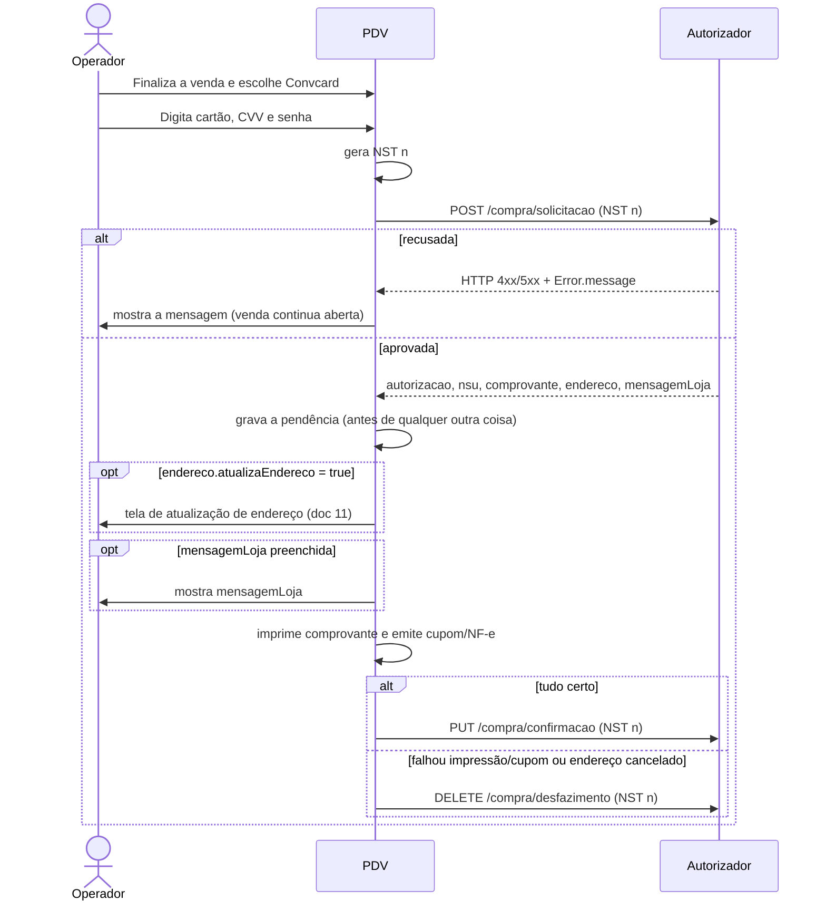

# 03 - Compra com cartão

## Objetivo

Pagar uma venda com o cartão Convcard digitado no PDV (número + CVV e, quando
exigida, senha) ou com um [token de cartão](12-token.md).

## Endpoints

| Etapa | Método | Endpoint | Corpo | Resposta |
| --- | --- | --- | --- | --- |
| Solicitação | POST | `/compra/solicitacao` | `SolicitacaoCompraModel` | `RetornoMovimentoModel` |
| Confirmação | PUT | `/compra/confirmacao` | `MovimentoModel` | 200 sem corpo |
| Desfazimento | DELETE | `/compra/desfazimento` | `MovimentoModel` | 200 sem corpo |

## Fluxo



### Passo a passo

1. Monte os dados da venda: valor total, parcelas, número da nota (se usado), produtos e, se aplicável, a receita médica.
2. Gere um **NST novo**.
3. Envie `POST /compra/solicitacao`.
4. Se aprovada, **grave a pendência** (NST, cartão, CVV, valor e `autorizacao` retornada) antes de seguir. Ela é o que permite confirmar ou desfazer, inclusive depois de uma queda do PDV.
5. Se `endereco.atualizaEndereco` vier `true`, peça o endereço atualizado ao portador ([doc 11](11-atualizacao-endereco.md)). Se o operador cancelar, **desfaça** a compra.
6. Se `mensagemLoja` vier preenchida, mostre ao operador.
7. Imprima o comprovante ([doc 13](13-comprovantes-e-reimpressao.md)) e conclua a venda no PDV (documento fiscal, baixa de estoque etc.).
8. Deu tudo certo: `PUT /compra/confirmacao`. Algo falhou: `DELETE /compra/desfazimento`. Sempre com o **mesmo NST** da solicitação.
9. Remova a pendência somente depois de o autorizador responder com sucesso.

## Solicitação

**SolicitacaoCompraModel**

| Campo | Tipo | Obrigatório | Descrição | Exemplo |
| --- | --- | --- | --- | --- |
| `nst` | integer (int64) | sim | Número sequencial da transação Este número deve permanecer o mesmo durante todo o processamento da operação em tratamento, mesmo que envolva mais de um fluxo de mensagens (fluxos com continuação). (mín. 1, máx. 9999999999) | `1239` |
| `nomeSoftware` | string | sim | Nome do Software | `Card Aut App` |
| `versaoSoftware` | string | sim | Versão Software | `1.205.790` |
| `identificadorLoja` | string | sim | Identificação da loja | `01c760b2-a9db-429c-ad60-d926f49878cd` |
| `qtdParcelas` | integer (int32) | sim | Quantidade de parcelas (mín. 1) | `1` |
| `valor` | number | sim | Valor do Movimento (mín. 0.01) | `1.5` |
| `numeroNota` | integer (int32) | não | Número da Nota (Cupom Fiscal ou Nota Fiscal) | `123` |
| `receita` | boolean | não | Identificador da Compra com Receita | `false` |
| `dataReceita` | string (date-time) | não | Data da Receita Obrigatório Caso receita = true | `2023-12-29T09:27:48.50657021-03:00` |
| `numeroCrm` | string | não | Número CRM do Médico da Receita Obrigatório Caso receita = true | `12345` |
| `ufMedico` | string | não | UF do Médico da Receita Obrigatório Caso receita = true (até 2 caracteres) | `SC` |
| `produtos` | ProdutoModel[] | não | Lista de Produtos |  |
| `cartao` | string | sim | Número do cartão ou Token | `1111111111111111111 ou 0a2e7a26-37ab-444c-a9d2-e9e44af0b789` |
| `cvv` | string | não | Número CVV do cartão Não é necessário informar o número CVV do cartão ao fornecer o token. | `123` |
| `senha` | string | não | Senha do cartão Não é necessário informar a senha do cartão ao fornecer o token. | `1234` |

**ProdutoModel**

| Campo | Tipo | Obrigatório | Descrição | Exemplo |
| --- | --- | --- | --- | --- |
| `codigoBarras` | integer (int64) | sim | Código de Barras do Produto (EAN13) | `7898906181779` |
| `descricao` | string | sim | Descrição do Produto | `produto teste 1` |
| `quantidade` | integer (int32) | sim | Quantidade do Produto (mín. 1) | `2` |
| `valor` | number | sim | Valor do Produto (mín. 0.01) | `4.5` |
| `tipo` | string [E, G, S, M, O] | sim | Tipo do Produto da Lista: E: Ético; G: Genérico; S: Similar; M: Manipulado; O: Outros; | `O` |
| `valorUnitario` | number | sim | Valor Unitário do Produto (mín. 0.01) | `0` |
| `percentualDesconto` | number | sim | Percentual de Desconto do Produto | `0` |
| `valorDesconto` | number | sim | Valor de Desconto do Produto | `0` |
| `valorUnitarioLiquido` | number | sim | Valor Unitário Liquido do Produto | `2.25` |

### Exemplo

```json
{
  "nst": 1239,
  "nomeSoftware": "PDV Convcard Exemplo",
  "versaoSoftware": "1.0.0",
  "identificadorLoja": "01c760b2-a9db-429c-ad60-d926f49878cd",
  "qtdParcelas": 1,
  "valor": 38.15,
  "numeroNota": 123,
  "receita": false,
  "cartao": "1111111111111111111",
  "cvv": "123",
  "senha": "1234",
  "produtos": [
    {
      "codigoBarras": 7890000000011,
      "descricao": "CAFE TORRADO 250G",
      "quantidade": 1,
      "valor": 8.9,
      "tipo": "O",
      "valorUnitario": 8.9,
      "percentualDesconto": 0,
      "valorDesconto": 0,
      "valorUnitarioLiquido": 8.9
    },
    {
      "codigoBarras": 7890000000028,
      "descricao": "CAMISETA ALGODAO M",
      "quantidade": 1,
      "valor": 29.25,
      "tipo": "O",
      "valorUnitario": 32.5,
      "percentualDesconto": 10,
      "valorDesconto": 3.25,
      "valorUnitarioLiquido": 29.25
    }
  ]
}
```

## Resposta (HTTP 200)

**RetornoMovimentoModel**

| Campo | Tipo | Obrigatório | Descrição | Exemplo |
| --- | --- | --- | --- | --- |
| `cartao` | string | não | Número do Cartão Mascarado | `11XXXXXXXXXXXX11111` |
| `usuario` | string | não | Nome do Usuário | `USUARIO TESTE` |
| `saldo` | number | não | Saldo do Usuário | `459.55` |
| `valor` | number | não | Valor do Movimento | `1.5` |
| `autorizacao` | integer (int32) | não | Número da autorização | `123` |
| `data` | string (date-time) | não | Data e Hora do Movimento | `2023-12-29T09:27:48.50657021-03:00` |
| `nsu` | integer (int64) | não | Numero Sequencial Único | `12345678` |
| `comprovante` | string | não | Comprovante a ser impresso, separado por '@' O retorno desta informação deve ser solicitado a Convcard | `EXEMPLO COMPROVANTE         @CREDENCIADA EXEMPLO  @Cartao Nu...` |
| `endereco` | EnderecoModel | não | Endereço |  |
| `bin` | string | não | BIN do cartão | `123456` |
| `rede` | string | não | Administradora do cartão | `REDE DEMONSTRACAO` |
| `bandeira` | string | não | Bandeira do cartão | `CONVCARD` |
| `mesAnoRefer` | string | não | Mês/ano referência do movimento | `11/2025` |
| `mensagemLoja` | string | não | Mensagem a ser exibida para a loja |  |

**EnderecoModel**

| Campo | Tipo | Obrigatório | Descrição | Exemplo |
| --- | --- | --- | --- | --- |
| `atualizaEndereco` | boolean | não | Indica se o endereço deve ser atualizado | `true` |
| `cep` | string | não | Número do CEP | `88704001` |
| `endereco` | string | não | Endereço | `Rua das Flores` |
| `complemento` | string | não | Complemento do endereço | `Apartamento 101` |
| `numero` | string | não | Número do endereço | `123` |
| `bairro` | string | não | Bairro | `Centro` |
| `cidade` | string | não | Cidade | `Florianópolis` |
| `estado` | string | não | Estado | `SC` |

```json
{
  "cartao": "11XXXXXXXXXXXX11111",
  "usuario": "USUARIO TESTE",
  "saldo": 459.55,
  "valor": 38.15,
  "autorizacao": 4321,
  "data": "2026-10-23T14:41:34-03:00",
  "nsu": 998877,
  "comprovante": "EXEMPLO COMPROVANTE@CREDENCIADA EXEMPLO@Cartao Numero: 11xxxxxxxxxxxx11111@...@@",
  "endereco": { "atualizaEndereco": false },
  "bin": "123456",
  "rede": "REDE DEMONSTRACAO",
  "bandeira": "CONVCARD",
  "mesAnoRefer": "11/2026",
  "mensagemLoja": ""
}
```

## Confirmação e desfazimento

Mesmo corpo (`MovimentoModel`) para confirmação e desfazimento:

**MovimentoModel**

| Campo | Tipo | Obrigatório | Descrição | Exemplo |
| --- | --- | --- | --- | --- |
| `nst` | integer (int64) | sim | Número sequencial da transação Este número deve permanecer o mesmo durante todo o processamento da operação em tratamento, mesmo que envolva mais de um fluxo de mensagens (fluxos com continuação). (mín. 1, máx. 9999999999) | `1239` |
| `nomeSoftware` | string | sim | Nome do Software | `Card Aut App` |
| `versaoSoftware` | string | sim | Versão Software | `1.205.790` |
| `identificadorLoja` | string | sim | Identificação da loja | `01c760b2-a9db-429c-ad60-d926f49878cd` |
| `cartao` | string | sim | Número do cartão ou Token | `1111111111111111111 ou 0a2e7a26-37ab-444c-a9d2-e9e44af0b789` |
| `cvv` | string | não | Número CVV do cartão Não é necessário informar o número CVV do cartão ao fornecer o token. | `123` |
| `valor` | number | sim | Valor do Movimento (mín. 0.01) | `1.5` |
| `autorizacao` | integer (int32) | sim | Número da autorização | `123` |

```json
{
  "nst": 1239,
  "nomeSoftware": "PDV Convcard Exemplo",
  "versaoSoftware": "1.0.0",
  "identificadorLoja": "01c760b2-a9db-429c-ad60-d926f49878cd",
  "cartao": "1111111111111111111",
  "cvv": "123",
  "valor": 38.15,
  "autorizacao": 4321
}
```

- `nst`: o **mesmo** da solicitação.
- `cartao`, `cvv` e `valor`: os enviados na solicitação.
- `autorizacao`: a devolvida pela solicitação.
- Resposta: HTTP 200 sem corpo.

## Regras e validações

### Da API (swagger)

- `cartao` aceita o **número do cartão** ou um **token** ([doc 12](12-token.md)). Com token, CVV e senha não são necessários.
- `qtdParcelas` ≥ 1 e `valor` ≥ 0,01.
- Receita médica é **opcional** e só se aplica a quem vende com receita: `receita = true` torna obrigatórios `dataReceita` (date-time), `numeroCrm` e `ufMedico` (2 letras). Nas demais vendas, envie `receita = false` ou omita.
- `produtos` é opcional; se enviado, todos os campos do `ProdutoModel` são obrigatórios. `tipo`: `E` ético, `G` genérico, `S` similar e `M` manipulado classificam medicamentos; para qualquer outro item use `O` (outros).

### Da tela do exemplo (boas práticas, não exigidas pela API)

- CVV habilitado assim que o cartão tem algum dígito e obrigatório para cartões de 19 dígitos.
- Senha habilitada só para cartões de 19 dígitos cujo 7º dígito é `1`.
- Campos de receita só aparecem com a configuração "Enviar dados receita".
- `numeroNota` só é enviado com a configuração "Enviar número nota".
- Data da receita: o exemplo envia o início do dia no fuso local em ISO 8601.

### Montagem dos produtos (como o exemplo calcula)

| Campo | Cálculo no exemplo |
| --- | --- |
| `valorUnitarioLiquido` | `valorUnitario - (valorUnitario × percentualDesconto / 100)` |
| `valor` | `quantidade × valorUnitarioLiquido` (total do item) |
| `valorDesconto` | desconto total do item (`quantidade × desconto unitário`) |

O swagger não detalha se `valorDesconto` é unitário ou total do item; confirme
com a Convcard a regra esperada para o seu caso.

## Exceções

| Situação | O que fazer |
| --- | --- |
| Solicitação recusada (HTTP 4xx/5xx) | Mostre `message` (e `code`/`nsu`, se vierem). Nada a desfazer: não houve aprovação |
| Erro de rede/timeout **na solicitação** | O PDV não sabe se o autorizador aprovou e não recebeu a `autorizacao`, então não há pendência gravada para desfazer. O exemplo trata como não aprovada e informa o operador. Combine com a Convcard o procedimento para esse caso |
| Operador cancela a tela antes de enviar | Nada a fazer na API |
| Atualização de endereço cancelada | Desfaça a compra |
| Falha ao imprimir o comprovante ou emitir o cupom | Desfaça a compra |
| Erro na **confirmação** (rede, 5xx) | Mantenha a pendência e tente de novo; não remova antes do sucesso ([doc 05](05-confirmacao-desfazimento-e-pendencias.md)) |
| PDV fechou entre a aprovação e a confirmação | Ao abrir de novo, desfaça a pendência gravada |
| Já existe uma pendência ao iniciar nova compra | Desfaça a pendência anterior antes de solicitar a nova |

## Como implementar (resumo)

```ts
// 1. Solicitação
const nst = proximoNst();
const retorno = await post('/compra/solicitacao', { ...base(nst), ...dadosVenda, cartao, cvv, senha });

// 2. Grava a pendência ANTES de qualquer outra coisa
salvarPendente({ tipo: 'COMPRA', movimento: { ...base(nst), cartao, cvv, valor, autorizacao: retorno.autorizacao } });

try {
  if (retorno.endereco?.atualizaEndereco) await atualizarEndereco(cartao, retorno.endereco); // lança se cancelado
  if (retorno.mensagemLoja) await mostrar(retorno.mensagemLoja);
  await imprimir(retorno.comprovante);
  await emitirCupom();
} catch (e) {
  await del('/compra/desfazimento', pendente.movimento); // 3b
  removerPendente();
  throw e;
}

await put('/compra/confirmacao', pendente.movimento); // 3a
removerPendente();
```

## No exemplo

| O quê | Onde |
| --- | --- |
| Tela de venda (F2 envia, F3 QR Code, Esc cancela) | `src/angular/app/telas/venda-cartao/` |
| Fluxo da venda (abre a tela, finaliza, registra a venda) | `finalizarVenda()` em `src/angular/app/pdv/venda.component.ts` |
| Pós-aprovação (endereço, mensagem, impressão, confirmação) | `src/angular/app/core/transacao.service.ts` |
| Chamada à API e gravação da pendência | `solicitarCompra()` em `src/electron/convcard/servico.ts` |
