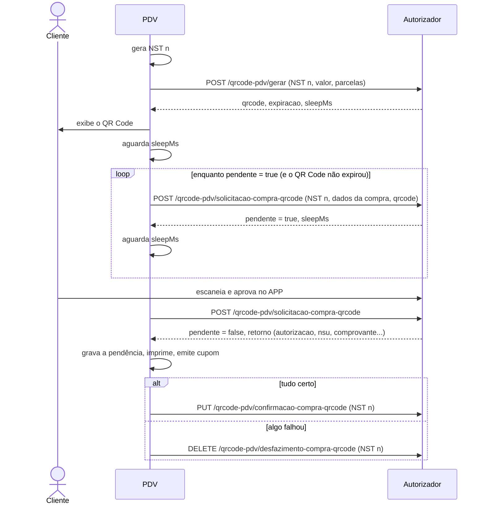

# 04 - Compra com QR Code (QRCode PDV)

## Objetivo

Pagar a venda sem digitar o cartão: o PDV exibe um QR Code, o cliente escaneia
com o aplicativo Convcard e aprova. Segundo o swagger, este é o modelo
**padrão de mercado** e funciona como a compra por cartão: solicitação +
confirmação/desfazimento pelo PDV.

## Endpoints

| Etapa | Método | Endpoint | Corpo | Resposta |
| --- | --- | --- | --- | --- |
| Gerar QR Code | POST | `/qrcode-pdv/gerar` | `SolicitacaoQrCodeModel` | `RetornoQrCodeModel` |
| Solicitação (pooling) | POST | `/qrcode-pdv/solicitacao-compra-qrcode` | `SolicitacaoCompraQrCodeModel` | `RetornoSolicitacaoQrCodeModel` |
| Confirmação | PUT | `/qrcode-pdv/confirmacao-compra-qrcode` | `MovimentoQrCodeModel` | 200 sem corpo |
| Desfazimento | DELETE | `/qrcode-pdv/desfazimento-compra-qrcode` | `MovimentoQrCodeModel` | 200 sem corpo |

## Fluxo

Resumo do swagger:

1. PDV gera o QR Code (`/qrcode-pdv/gerar`).
2. PDV inicia um pooling em `/qrcode-pdv/solicitacao-compra-qrcode`, tentando realizar a solicitação.
3. O usuário, pelo APP, escaneia o QR Code, faz a vinculação e o APP notifica o pooling do PDV.
4. PDV imprime o comprovante.
5. PDV envia a confirmação ou o desfazimento.



### Passo a passo

1. Gere um **NST novo** e chame `/qrcode-pdv/gerar` com `valor` e `qtdParcelas`.
2. Exiba o QR Code (o conteúdo de `qrcode`) e, se quiser, uma contagem regressiva até `expiracao`.
3. Aguarde `sleepMs` e chame `/qrcode-pdv/solicitacao-compra-qrcode` com o **mesmo NST**, os **mesmos** `valor` e `qtdParcelas`, os demais dados da compra (nota, produtos e, se aplicável, receita) e o `qrcode`.
4. Enquanto `pendente = true`: aguarde o `sleepMs` devolvido e chame de novo (mesmo NST e mesmos dados).
5. Quando `pendente = false` e `retorno` vier preenchido: a compra foi aprovada. **Grave a pendência** (NST, `qrcode`, `valor`, `retorno.autorizacao`).
6. Siga o mesmo pós-aprovação da compra por cartão: mensagem da loja, comprovante, cupom e confirmação ou desfazimento ([doc 03](03-compra-cartao.md)).

> A chamada de solicitação é um **long pooling**: o servidor pode segurar a
> requisição alguns segundos antes de responder. Use um timeout de leitura
> generoso (o exemplo usa 60 segundos).

## Gerar QR Code

### Requisição

**SolicitacaoQrCodeModel**

| Campo | Tipo | Obrigatório | Descrição | Exemplo |
| --- | --- | --- | --- | --- |
| `nst` | integer (int64) | sim | Número sequencial da transação Este número deve permanecer o mesmo durante todo o processamento da operação em tratamento, mesmo que envolva mais de um fluxo de mensagens (fluxos com continuação). (mín. 1, máx. 9999999999) | `1239` |
| `nomeSoftware` | string | sim | Nome do Software | `Card Aut App` |
| `versaoSoftware` | string | sim | Versão Software | `1.205.790` |
| `identificadorLoja` | string | sim | Identificação da loja | `01c760b2-a9db-429c-ad60-d926f49878cd` |
| `qtdParcelas` | integer (int32) | sim | Quantidade de parcelas (mín. 1) | `1` |
| `valor` | number | sim | Valor do Movimento (mín. 0.01) | `1.5` |

```json
{
  "nst": 1240,
  "nomeSoftware": "PDV Convcard Exemplo",
  "versaoSoftware": "1.0.0",
  "identificadorLoja": "01c760b2-a9db-429c-ad60-d926f49878cd",
  "qtdParcelas": 1,
  "valor": 19.9
}
```

### Resposta

**RetornoQrCodeModel**

| Campo | Tipo | Obrigatório | Descrição | Exemplo |
| --- | --- | --- | --- | --- |
| `nsu` | integer (int64) | não | Numero Sequencial Único | `12345678` |
| `qrcode` | string | não | Conteúdo QRCode | `XXXXXX` |
| `expiracao` | string (date-time) | não | Expiração do QRCode | `2023-12-29T09:27:48.50657021-03:00` |
| `sleepMs` | integer (int64) | não | Tempo em millisegundos que o PDV deve aguardar antes de iniciar o pooling | `10` |

```json
{
  "qrcode": "ABCDEF",
  "expiracao": "2026-10-23T14:43:43-03:00",
  "sleepMs": 500
}
```

O exemplo transforma `qrcode` numa imagem (biblioteca `qrcode`) e exibe o
conteúdo abaixo dela. Códigos de 6 caracteres aparecem como `ABC-DEF` para
facilitar a leitura caso o cliente precise digitar.

## Solicitação (pooling)

### Requisição

**SolicitacaoCompraQrCodeModel**

| Campo | Tipo | Obrigatório | Descrição | Exemplo |
| --- | --- | --- | --- | --- |
| `nst` | integer (int64) | sim | Número sequencial da transação Este número deve permanecer o mesmo durante todo o processamento da operação em tratamento, mesmo que envolva mais de um fluxo de mensagens (fluxos com continuação). (mín. 1, máx. 9999999999) | `1239` |
| `nomeSoftware` | string | sim | Nome do Software | `Card Aut App` |
| `versaoSoftware` | string | sim | Versão Software | `1.205.790` |
| `identificadorLoja` | string | sim | Identificação da loja | `01c760b2-a9db-429c-ad60-d926f49878cd` |
| `qtdParcelas` | integer (int32) | sim | Quantidade de parcelas (mín. 1) | `1` |
| `valor` | number | sim | Valor do Movimento (mín. 0.01) | `1.5` |
| `numeroNota` | integer (int32) | não | Número da Nota (Cupom Fiscal ou Nota Fiscal) | `123` |
| `receita` | boolean | não | Identificador da Compra com Receita | `false` |
| `dataReceita` | string (date-time) | não | Data da Receita Obrigatório Caso receita = true | `2023-12-29T09:27:48.50657021-03:00` |
| `numeroCrm` | string | não | Número CRM do Médico da Receita Obrigatório Caso receita = true | `12345` |
| `ufMedico` | string | não | UF do Médico da Receita Obrigatório Caso receita = true (até 2 caracteres) | `SC` |
| `produtos` | ProdutoModel[] | não | Lista de Produtos |  |
| `qrcode` | string | sim | Conteúdo QRCode | `XXXXXX` |

**ProdutoModel**

| Campo | Tipo | Obrigatório | Descrição | Exemplo |
| --- | --- | --- | --- | --- |
| `codigoBarras` | integer (int64) | sim | Código de Barras do Produto (EAN13) | `7898906181779` |
| `descricao` | string | sim | Descrição do Produto | `produto teste 1` |
| `quantidade` | integer (int32) | sim | Quantidade do Produto (mín. 1) | `2` |
| `valor` | number | sim | Valor do Produto (mín. 0.01) | `4.5` |
| `tipo` | string [E, G, S, M, O] | sim | Tipo do Produto da Lista: E: Ético; G: Genérico; S: Similar; M: Manipulado; O: Outros; | `O` |
| `valorUnitario` | number | sim | Valor Unitário do Produto (mín. 0.01) | `0` |
| `percentualDesconto` | number | sim | Percentual de Desconto do Produto | `0` |
| `valorDesconto` | number | sim | Valor de Desconto do Produto | `0` |
| `valorUnitarioLiquido` | number | sim | Valor Unitário Liquido do Produto | `2.25` |

```json
{
  "nst": 1240,
  "nomeSoftware": "PDV Convcard Exemplo",
  "versaoSoftware": "1.0.0",
  "identificadorLoja": "01c760b2-a9db-429c-ad60-d926f49878cd",
  "qtdParcelas": 1,
  "valor": 19.9,
  "numeroNota": 124,
  "receita": false,
  "produtos": [ { "codigoBarras": 7890000000035, "descricao": "CANECA DE PORCELANA", "quantidade": 1, "valor": 18.9, "tipo": "O", "valorUnitario": 19.9, "percentualDesconto": 5, "valorDesconto": 1.0, "valorUnitarioLiquido": 18.9 } ],
  "qrcode": "ABCDEF"
}
```

### Resposta

**RetornoSolicitacaoQrCodeModel**

| Campo | Tipo | Obrigatório | Descrição | Exemplo |
| --- | --- | --- | --- | --- |
| `pendente` | boolean | sim | Indica se ainda está pendente de vinculo no aplicativo | `true` |
| `sleepMs` | integer (int64) | não | Tempo em millisegundos que o PDV deve aguardar antes de retentar o pooling | `10` |
| `retorno` | RetornoMovimentoModel | não | Retorno da solicitação em caso de sucesso |  |

**RetornoMovimentoModel**

| Campo | Tipo | Obrigatório | Descrição | Exemplo |
| --- | --- | --- | --- | --- |
| `cartao` | string | não | Número do Cartão Mascarado | `11XXXXXXXXXXXX11111` |
| `usuario` | string | não | Nome do Usuário | `USUARIO TESTE` |
| `saldo` | number | não | Saldo do Usuário | `459.55` |
| `valor` | number | não | Valor do Movimento | `1.5` |
| `autorizacao` | integer (int32) | não | Número da autorização | `123` |
| `data` | string (date-time) | não | Data e Hora do Movimento | `2023-12-29T09:27:48.50657021-03:00` |
| `nsu` | integer (int64) | não | Numero Sequencial Único | `12345678` |
| `comprovante` | string | não | Comprovante a ser impresso, separado por '@' O retorno desta informação deve ser solicitado a Convcard | `EXEMPLO COMPROVANTE         @CREDENCIADA EXEMPLO  @Cartao Nu...` |
| `endereco` | EnderecoModel | não | Endereço |  |
| `bin` | string | não | BIN do cartão | `123456` |
| `rede` | string | não | Administradora do cartão | `REDE DEMONSTRACAO` |
| `bandeira` | string | não | Bandeira do cartão | `CONVCARD` |
| `mesAnoRefer` | string | não | Mês/ano referência do movimento | `11/2025` |
| `mensagemLoja` | string | não | Mensagem a ser exibida para a loja |  |

**EnderecoModel**

| Campo | Tipo | Obrigatório | Descrição | Exemplo |
| --- | --- | --- | --- | --- |
| `atualizaEndereco` | boolean | não | Indica se o endereço deve ser atualizado | `true` |
| `cep` | string | não | Número do CEP | `88704001` |
| `endereco` | string | não | Endereço | `Rua das Flores` |
| `complemento` | string | não | Complemento do endereço | `Apartamento 101` |
| `numero` | string | não | Número do endereço | `123` |
| `bairro` | string | não | Bairro | `Centro` |
| `cidade` | string | não | Cidade | `Florianópolis` |
| `estado` | string | não | Estado | `SC` |

Ainda aguardando o cliente:

```json
{ "pendente": true, "sleepMs": 1000 }
```

Aprovada:

```json
{
  "pendente": false,
  "retorno": { "autorizacao": 5555, "nsu": 112233, "valor": 19.9, "comprovante": "..." }
}
```

## Confirmação e desfazimento

Mesmo corpo (`MovimentoQrCodeModel`) para os dois:

**MovimentoQrCodeModel**

| Campo | Tipo | Obrigatório | Descrição | Exemplo |
| --- | --- | --- | --- | --- |
| `nst` | integer (int64) | sim | Número sequencial da transação Este número deve permanecer o mesmo durante todo o processamento da operação em tratamento, mesmo que envolva mais de um fluxo de mensagens (fluxos com continuação). (mín. 1, máx. 9999999999) | `1239` |
| `nomeSoftware` | string | sim | Nome do Software | `Card Aut App` |
| `versaoSoftware` | string | sim | Versão Software | `1.205.790` |
| `identificadorLoja` | string | sim | Identificação da loja | `01c760b2-a9db-429c-ad60-d926f49878cd` |
| `qrcode` | string | sim | Conteúdo QRCode | `XXXXXX` |
| `valor` | number | sim | Valor do Movimento (mín. 0.01) | `1.5` |
| `autorizacao` | integer (int32) | sim | Número da autorização | `123` |

```json
{
  "nst": 1240,
  "nomeSoftware": "PDV Convcard Exemplo",
  "versaoSoftware": "1.0.0",
  "identificadorLoja": "01c760b2-a9db-429c-ad60-d926f49878cd",
  "qrcode": "ABCDEF",
  "valor": 19.9,
  "autorizacao": 5555
}
```

Guarde também o `qrcode` junto com a venda: ele identifica a compra num
[cancelamento futuro](06-cancelamento.md).

## Regras

- Use o **mesmo NST** em gerar, em todas as chamadas do pooling e na confirmação/desfazimento.
- Envie sempre os **mesmos** `valor` e `qtdParcelas` do gerar.
- Respeite o `sleepMs`: ele vem no gerar (antes da primeira chamada) e em cada resposta pendente (antes da próxima).
- O QR Code vale até `expiracao`.
- Na compra por QR Code, o PDV não envia cartão, CVV nem senha: o cliente se identifica pelo APP. O exemplo só habilita o botão de QR Code com o campo cartão vazio.
- A compra por QR Code não tem atualização de endereço (não há cartão digitado).

## Exceções

| Situação | O que fazer |
| --- | --- |
| Erro ao gerar o QR Code | Mostre `message`; volte para a tela de pagamento |
| QR Code expirou (passou de `expiracao`) | Encerre o pooling e informe; o operador pode gerar outro |
| Erro HTTP numa chamada do pooling | Encerre o pooling e mostre a mensagem |
| `pendente = false` sem `retorno` | Trate como não concluída |
| Operador cancela durante o pooling | Pare de chamar o pooling. **Se uma chamada em andamento voltar aprovada depois do cancelamento, desfaça** (o PDV não vai concluir aquela venda) |
| Falha na impressão/cupom depois da aprovação | `DELETE /qrcode-pdv/desfazimento-compra-qrcode` |
| Erro na confirmação | Mantenha a pendência e tente de novo ([doc 05](05-confirmacao-desfazimento-e-pendencias.md)) |

## Como implementar (resumo)

```ts
const nst = proximoNst();
const qr = await post('/qrcode-pdv/gerar', { ...base(nst), valor, qtdParcelas });
exibirQrCode(qr.qrcode, qr.expiracao);

await aguardar(qr.sleepMs);
let resposta = await post('/qrcode-pdv/solicitacao-compra-qrcode', { ...base(nst), ...dadosCompra, qrcode: qr.qrcode });
while (resposta.pendente && !cancelado && Date.now() < Date.parse(qr.expiracao)) {
  await aguardar(resposta.sleepMs);
  resposta = await post('/qrcode-pdv/solicitacao-compra-qrcode', { ...base(nst), ...dadosCompra, qrcode: qr.qrcode });
}

if (!resposta.pendente && resposta.retorno) {
  const movimento = { ...base(nst), qrcode: qr.qrcode, valor, autorizacao: resposta.retorno.autorizacao };
  salvarPendente({ tipo: 'COMPRA_QRCODE', movimento });
  if (cancelado) await del('/qrcode-pdv/desfazimento-compra-qrcode', movimento); // voltou aprovada depois do cancelamento
  // senão: imprime, emite cupom e confirma (PUT /qrcode-pdv/confirmacao-compra-qrcode)
}
```

## No exemplo

| O quê | Onde |
| --- | --- |
| Tela do QR Code (gerar, exibir, contagem, pooling) | `src/angular/app/telas/qrcode/` |
| Botão "QR Code [F3]" na tela de venda | `src/angular/app/telas/venda-cartao/` |
| Chamadas e gravação da pendência | `gerarQrCode()` e `solicitarCompraQrCode()` em `src/electron/convcard/servico.ts` |
