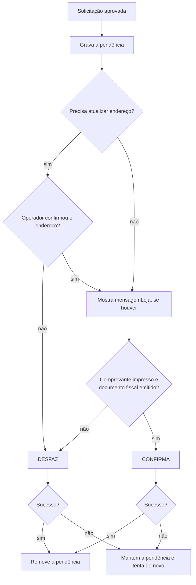

# 05 - Confirmação, desfazimento e pendências

Este é o ponto mais importante da integração: **toda transação aprovada
precisa ser confirmada ou desfeita**. Uma aprovação esquecida pode cobrar o
cliente por uma venda que não aconteceu no caixa (ou o contrário).

## Conceitos

| Termo | O que é |
| --- | --- |
| **Pendência** | Transação aprovada pelo autorizador que ainda não foi confirmada nem desfeita |
| **Confirmação** | Avisa que a operação foi concluída no PDV (comprovante impresso, cupom emitido). Efetiva a transação |
| **Desfazimento** | Avisa que a operação não foi concluída no PDV. Estorna a transação aprovada |
| **Cancelamento** | Estorna uma compra **já confirmada**. É uma nova transação, com solicitação e confirmação próprias ([doc 06](06-cancelamento.md)) |

## Endpoints por tipo de transação

| Transação | Confirmação | Desfazimento | Corpo |
| --- | --- | --- | --- |
| Compra com cartão | `PUT /compra/confirmacao` | `DELETE /compra/desfazimento` | `MovimentoModel` |
| Compra com QR Code | `PUT /qrcode-pdv/confirmacao-compra-qrcode` | `DELETE /qrcode-pdv/desfazimento-compra-qrcode` | `MovimentoQrCodeModel` |
| Cancelamento | `DELETE /cancelamento/confirmacao` | `DELETE /cancelamento/desfazimento` | `MovimentoModel` |
| Recebimento de fatura | `PUT /pagamento/confirmacao-pagamento` | não existe | `ConfirmacaoPagamentoModel` |
| Recebimento antecipado | `PUT /pagamento/confirmacao-pagamento-antecipado` | não existe | `ConfirmacaoPagamentoAntecipadoModel` |

Todas respondem **HTTP 200 sem corpo** em caso de sucesso.

> **Recebimentos não têm endpoint de desfazimento.** O exemplo, quando algo
> falha depois da solicitação de um recebimento, simplesmente não envia a
> confirmação e descarta a pendência. Confirme com a Convcard o comportamento
> esperado de um pagamento solicitado e não confirmado.

## Corpos

**MovimentoModel** (compra e cancelamento com cartão):

**MovimentoModel**

| Campo | Tipo | Obrigatório | Descrição | Exemplo |
| --- | --- | --- | --- | --- |
| `nst` | integer (int64) | sim | Número sequencial da transação Este número deve permanecer o mesmo durante todo o processamento da operação em tratamento, mesmo que envolva mais de um fluxo de mensagens (fluxos com continuação). (mín. 1, máx. 9999999999) | `1239` |
| `nomeSoftware` | string | sim | Nome do Software | `Card Aut App` |
| `versaoSoftware` | string | sim | Versão Software | `1.205.790` |
| `identificadorLoja` | string | sim | Identificação da loja | `01c760b2-a9db-429c-ad60-d926f49878cd` |
| `cartao` | string | sim | Número do cartão ou Token | `1111111111111111111 ou 0a2e7a26-37ab-444c-a9d2-e9e44af0b789` |
| `cvv` | string | não | Número CVV do cartão Não é necessário informar o número CVV do cartão ao fornecer o token. | `123` |
| `valor` | number | sim | Valor do Movimento (mín. 0.01) | `1.5` |
| `autorizacao` | integer (int32) | sim | Número da autorização | `123` |

**MovimentoQrCodeModel** (compra com QR Code):

**MovimentoQrCodeModel**

| Campo | Tipo | Obrigatório | Descrição | Exemplo |
| --- | --- | --- | --- | --- |
| `nst` | integer (int64) | sim | Número sequencial da transação Este número deve permanecer o mesmo durante todo o processamento da operação em tratamento, mesmo que envolva mais de um fluxo de mensagens (fluxos com continuação). (mín. 1, máx. 9999999999) | `1239` |
| `nomeSoftware` | string | sim | Nome do Software | `Card Aut App` |
| `versaoSoftware` | string | sim | Versão Software | `1.205.790` |
| `identificadorLoja` | string | sim | Identificação da loja | `01c760b2-a9db-429c-ad60-d926f49878cd` |
| `qrcode` | string | sim | Conteúdo QRCode | `XXXXXX` |
| `valor` | number | sim | Valor do Movimento (mín. 0.01) | `1.5` |
| `autorizacao` | integer (int32) | sim | Número da autorização | `123` |

Corpos de confirmação de recebimento: veja os docs [09](09-recebimento-fatura.md) e [10](10-recebimento-antecipado.md).

### De onde vem cada valor

| Campo | Origem |
| --- | --- |
| `nst` | O **mesmo** da solicitação (nunca um NST novo) |
| `cartao` / `cvv` | Os enviados na solicitação |
| `qrcode` | O conteúdo do QR Code usado na compra |
| `valor` | O valor da solicitação |
| `autorizacao` | A `autorizacao` **devolvida pela solicitação desta transação**. No cancelamento, é a autorização devolvida pelo cancelamento, não a da compra original |

## Quando confirmar e quando desfazer



| Situação | Ação |
| --- | --- |
| Venda concluída no PDV | Confirmar |
| Falha na impressão do comprovante | Desfazer |
| Falha ao emitir o documento fiscal / gravar a venda | Desfazer |
| Operador desistiu depois da aprovação | Desfazer |
| Atualização de endereço solicitada e cancelada | Desfazer |
| PDV fechou/travou entre a aprovação e a confirmação | Desfazer ao reabrir |
| Nova transação iniciada com pendência anterior | Desfazer a anterior antes |

## Persistência da pendência

Grave a pendência **imediatamente depois da aprovação**, antes de mostrar
qualquer tela, e remova **somente depois** que o autorizador responder com
sucesso à confirmação ou ao desfazimento.

Guarde o suficiente para montar o corpo da confirmação/desfazimento sem
depender da memória do programa:

| Dado | Por quê |
| --- | --- |
| Tipo da transação | Define o endpoint (tabela acima) |
| Corpo pronto da confirmação/desfazimento | Mesmo NST, cartão/QR Code, valor e autorização |
| Comprovante | Para a reimpressão ([doc 13](13-comprovantes-e-reimpressao.md)) |

> **Dados sensíveis:** o PDV não deve gravar número do cartão, CVV ou QR Code
> no banco. A pendência é a **única exceção**: o corpo da confirmação/desfazimento
> leva o cartão (ou o QR Code), e ele precisa sobreviver a uma queda do PDV para
> que a transação possa ser desfeita. Por isso a pendência é **apagada assim que
> for usada** (confirmada, desfeita ou recusada pelo autorizador) e gravada
> **sempre criptografada**.

No exemplo, a pendência fica na tabela SQLite `transacao_pendente`
(`src/electron/armazenamento.ts`), com no máximo uma linha. O registro inteiro
(tipo, corpo da confirmação/desfazimento e comprovante) é serializado em JSON
e criptografado (`src/electron/cripto.ts`):

| Sistema | Como criptografa |
| --- | --- |
| Windows | `safeStorage` do Electron = DPAPI (chave ligada ao usuário do Windows) |
| Linux com cofre de senhas (gnome-keyring/libsecret, KWallet) | `safeStorage` do Electron, chave no cofre |
| Linux sem cofre | AES-256-GCM com chave aleatória em `<userData>/pendencia.key`, permissão `0600` |
| macOS | `safeStorage` do Electron = Keychain |

No Linux sem cofre o `safeStorage` usa o backend `basic_text`, que criptografa
com uma senha fixa conhecida (não protege nada); por isso o exemplo usa a
chave local nesse caso. O primeiro byte do dado gravado indica o método.

```sql
CREATE TABLE transacao_pendente (
  id    INTEGER PRIMARY KEY CHECK (id = 1),
  dados BLOB NOT NULL  -- JSON do registro, criptografado
);
```

```ts
salvarPendente(p)  -> await criptografar(JSON.stringify(p))
obterPendente()    -> JSON.parse(await descriptografar(dados))
```

- Sem criptografia disponível, a pendência **não** é gravada em texto puro: a
  transação é interrompida com erro.
- Se o registro não puder ser descriptografado (banco copiado de outro
  usuário/máquina), ele é descartado.
- O banco é aberto com `PRAGMA secure_delete = ON`, para que a pendência
  apagada não continue legível nas páginas livres do arquivo.
- Em outras linguagens use o equivalente: DPAPI (`ProtectedData` no .NET,
  `CryptProtectData` no Delphi/C++) ou AES com chave guardada fora do banco.

### Recuperação

O exemplo aplica duas regras de recuperação:

1. **Ao abrir o PDV** (`desfazerPendenteAoIniciar`): se houver pendência, ela é desfeita. Se o desfazimento falhar (sem rede, por exemplo), a pendência continua gravada.
2. **Antes de cada nova transação** (`desfazerPendenteAnterior`): se ainda houver pendência, ela é desfeita. Se não for possível desfazer, a nova transação é bloqueada com a mensagem "Existe uma transação anterior pendente que não pôde ser desfeita".

## Exceções

| Situação | O que fazer |
| --- | --- |
| Confirmação falhou por erro de rede/timeout/5xx | Mantenha a pendência e tente de novo |
| Desfazimento falhou | Mantenha a pendência; ela será desfeita ao reabrir o PDV ou antes da próxima transação |
| Confirmação/desfazimento devolveu erro de negócio (HTTP 4xx com `message`) | A pendência é descartada (reenviar não adianta). Mostre a mensagem e registre o caso para análise com a Convcard |

O swagger não descreve se reenviar uma confirmação já processada é aceito
(idempotência). Combine com a Convcard o procedimento para reenvios.

## No exemplo

| O quê | Onde |
| --- | --- |
| Endpoints por tipo, `confirmarPendente`, `desfazerPendente`, recuperação | `src/electron/convcard/servico.ts` (seção "Confirmação / desfazimento") |
| Persistência | `obterPendente`, `salvarPendente`, `removerPendente` em `src/electron/armazenamento.ts` |
| Decisão confirmar × desfazer depois da aprovação | `src/angular/app/core/transacao.service.ts` |
| Simulação de falha de impressão (botão "Falha na impressão [F3]") | `src/angular/app/dialogos/impressora.component.ts` |
