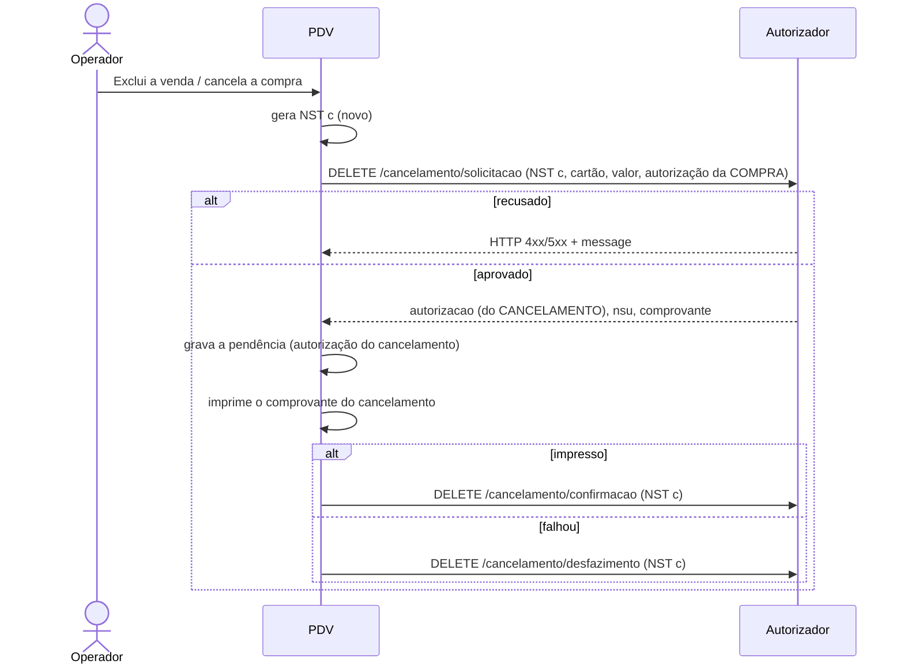

# 06 - Cancelamento de compra

## Objetivo

Estornar uma compra que **já foi confirmada**: devolução, venda excluída no PDV
ou lançamento errado. Para uma compra aprovada mas ainda **não confirmada**,
use o desfazimento ([doc 05](05-confirmacao-desfazimento-e-pendencias.md)).

O cancelamento é uma transação de duas etapas, com NST próprio: solicitação e
depois confirmação ou desfazimento.

> **O cancelamento é sempre pelo número do cartão**, inclusive para compras
> pagas com QR Code. O operador pede o cartão ao cliente (o PDV não guarda o
> número do cartão nem o QR Code).

## Endpoints

| Etapa | Método | Endpoint | Corpo | Resposta |
| --- | --- | --- | --- | --- |
| Solicitação | DELETE | `/cancelamento/solicitacao` | `MovimentoModel` | `RetornoMovimentoModel` |
| Confirmação | DELETE | `/cancelamento/confirmacao` | `MovimentoModel` | 200 sem corpo |
| Desfazimento | DELETE | `/cancelamento/desfazimento` | `MovimentoModel` | 200 sem corpo |

> Todos os endpoints de cancelamento são `DELETE` **com corpo JSON**.

## Fluxo



### Passo a passo

1. Identifique a compra original. O PDV guarda, para cada venda paga com Convcard, o **valor** e a **autorização** da compra. **Cartão, CVV e QR Code não são guardados**: no cancelamento o operador informa o cartão (+ CVV), mesmo que a compra tenha sido paga com QR Code.
2. Gere um **NST novo** (o cancelamento é uma nova transação).
3. Envie a solicitação com os dados da compra original (`autorizacao` = autorização da **compra**).
4. Se aprovado, grave a pendência com a `autorizacao` **devolvida pelo cancelamento**.
5. Imprima o comprovante do cancelamento e confirme. Se falhar, desfaça.

## Corpo: MovimentoModel

**MovimentoModel**

| Campo | Tipo | Obrigatório | Descrição | Exemplo |
| --- | --- | --- | --- | --- |
| `nst` | integer (int64) | sim | Número sequencial da transação Este número deve permanecer o mesmo durante todo o processamento da operação em tratamento, mesmo que envolva mais de um fluxo de mensagens (fluxos com continuação). (mín. 1, máx. 9999999999) | `1239` |
| `nomeSoftware` | string | sim | Nome do Software | `Card Aut App` |
| `versaoSoftware` | string | sim | Versão Software | `1.205.790` |
| `identificadorLoja` | string | sim | Identificação da loja | `01c760b2-a9db-429c-ad60-d926f49878cd` |
| `cartao` | string | sim | Número do cartão ou Token | `1111111111111111111 ou 0a2e7a26-37ab-444c-a9d2-e9e44af0b789` |
| `cvv` | string | não | Número CVV do cartão Não é necessário informar o número CVV do cartão ao fornecer o token. | `123` |
| `valor` | number | sim | Valor do Movimento (mín. 0.01) | `1.5` |
| `autorizacao` | integer (int32) | sim | Número da autorização | `123` |

```json
{
  "nst": 1301,
  "nomeSoftware": "PDV Convcard Exemplo",
  "versaoSoftware": "1.0.0",
  "identificadorLoja": "01c760b2-a9db-429c-ad60-d926f49878cd",
  "cartao": "1111111111111111111",
  "cvv": "123",
  "valor": 38.15,
  "autorizacao": 4321
}
```

## Resposta da solicitação

Mesmo modelo da compra (`RetornoMovimentoModel`): veja a tabela no
[doc 03](03-compra-cartao.md#resposta-http-200). Os campos usados no
cancelamento são `autorizacao`, `nsu`, `data`, `comprovante` e `mensagemLoja`.

## Confirmação e desfazimento do cancelamento

O corpo é o mesmo da solicitação, trocando:

- `autorizacao` → a autorização **devolvida pela solicitação de cancelamento**;
- `nst` → o NST do cancelamento (o mesmo da solicitação de cancelamento).

## Regras

- Cancelamento é para compra **confirmada**. Compra pendente se desfaz.
- O NST do cancelamento é novo; a autorização enviada na solicitação é a da compra.
- CVV: o exemplo exige CVV para cartões de 19 dígitos, como na venda.

## Rotas de cancelamento de QR Code

O swagger também tem `/qrcode-pdv/solicitacao-cancelamento-compra-qrcode`,
`/qrcode-pdv/confirmacao-cancelamento-compra-qrcode` e
`/qrcode-pdv/desfazimento-cancelamento-compra-qrcode` (corpo
`MovimentoQrCodeModel`, com acesso liberado pelo suporte Convcard). Elas **não
são o cancelamento do dia a dia** e não são usadas neste exemplo.

Servem para um cenário automático de **venda com múltiplas formas de
pagamento**: a parte Convcard (paga com QR Code) já foi confirmada e, em
seguida, falha a confirmação de outra forma de pagamento da mesma venda. Como
a transação Convcard já está confirmada, não dá mais para desfazê-la: o PDV
cancela automaticamente pelo QR Code, que ainda está em memória naquele
momento. Fora desse cenário, cancele sempre pelo cartão.

## Duas formas de cancelar no exemplo

| Forma | Quando | Endpoints |
| --- | --- | --- |
| **Excluir venda** (lista "Vendas finalizadas" do PDV) | Venda feita neste PDV (cartão ou QR Code); o PDV já tem valor e autorização e pede o cartão (+ CVV) | `/cancelamento/*` |
| **Cancelamento manual** (Funções → Cancelamento [F2]) | Venda de outro PDV/dia; o operador digita cartão, CVV, valor e autorização | `/cancelamento/*` |

## Exceções

| Situação | O que fazer |
| --- | --- |
| Solicitação recusada (compra não encontrada, já cancelada etc.) | Mostre `message`; nada a desfazer |
| Falha ao imprimir o comprovante do cancelamento | Desfaça o cancelamento |
| Erro na confirmação | Mantenha a pendência e tente de novo |

## No exemplo

| O quê | Onde |
| --- | --- |
| Excluir venda | `excluirVenda()` em `src/angular/app/pdv/venda.component.ts`, que abre `src/angular/app/telas/cancelamento/` com valor e autorização da venda |
| Cancelamento manual | `src/angular/app/telas/cancelamento/` |
| Chamadas e pendência | `solicitarCancelamento()` em `src/electron/convcard/servico.ts` |
