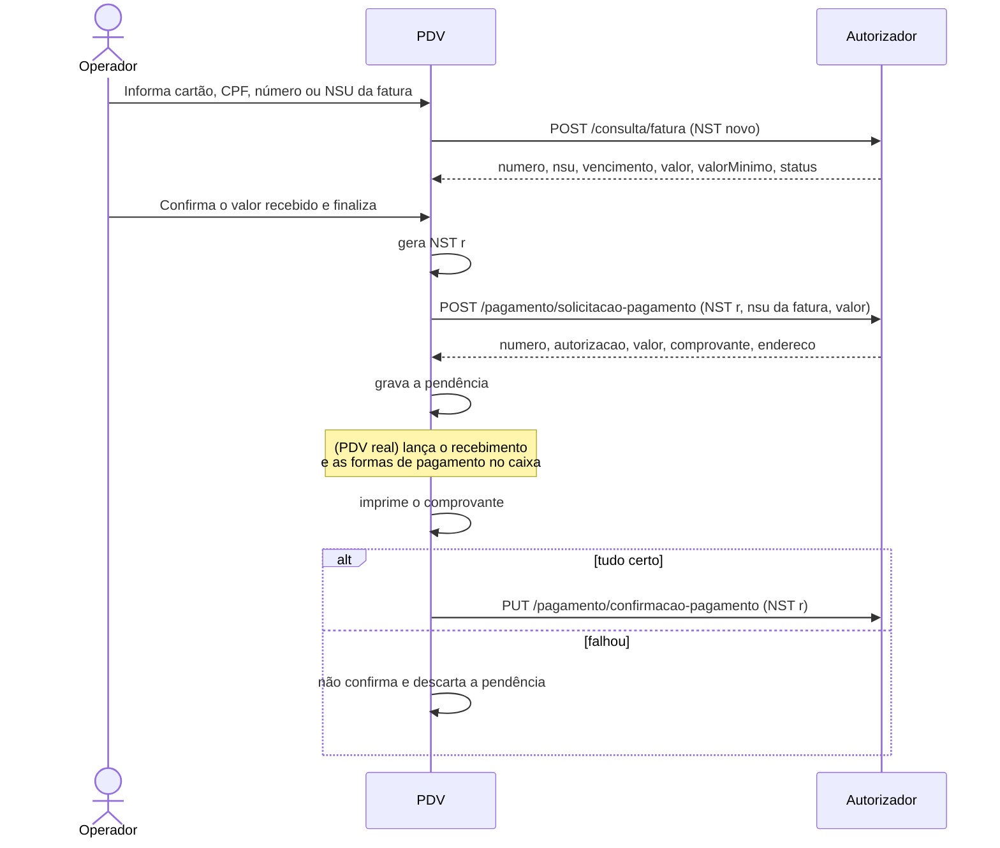

# 09 - Recebimento de fatura

## Objetivo

A loja recebe do portador o pagamento de uma **fatura fechada** (no caixa, em
dinheiro, cartão etc.) e informa a Convcard. A fatura é identificada pela
**NSU da fatura**.

Para pagar antes do fechamento da fatura, use o
[recebimento antecipado](10-recebimento-antecipado.md).

## Endpoints

| Etapa | Método | Endpoint | Corpo | Resposta |
| --- | --- | --- | --- | --- |
| Localizar a fatura | POST | `/consulta/fatura` (ou `/consulta/saldo`) | `ConsultaFaturaModel` | `FaturaModel` |
| Solicitação | POST | `/pagamento/solicitacao-pagamento` | `SolicitacaoPagamentoModel` | `PagamentoFaturaModel` |
| Confirmação | PUT | `/pagamento/confirmacao-pagamento` | `ConfirmacaoPagamentoModel` | 200 sem corpo |

Não existe endpoint de desfazimento de pagamento (ver [doc 05](05-confirmacao-desfazimento-e-pendencias.md)).

## Fluxo



### Passo a passo

1. Localize a fatura com `/consulta/fatura` ([doc 08](08-fatura.md)), filtrando por cartão, CPF, número ou NSU. Também dá para usar os dados de `fatura` devolvidos por `/consulta/saldo` ([doc 07](07-consulta-saldo.md)).
2. Mostre os dados (número, NSU, vencimento) e preencha o **valor recebido** com o `valor` da fatura. O operador pode alterá-lo.
3. Gere um **NST novo** e envie `POST /pagamento/solicitacao-pagamento` com a `nsu` da fatura e o `valor` recebido.
4. Grave a pendência (NST, NSU da fatura, valor e `autorizacao`).
5. Lance o recebimento no seu sistema (caixa, formas de pagamento). O exemplo não implementa essa parte.
6. Imprima o comprovante.
7. Confirme com `PUT /pagamento/confirmacao-pagamento` (mesmo NST).

## Solicitação

**SolicitacaoPagamentoModel**

| Campo | Tipo | Obrigatório | Descrição | Exemplo |
| --- | --- | --- | --- | --- |
| `nst` | integer (int64) | sim | Número sequencial da transação Este número deve permanecer o mesmo durante todo o processamento da operação em tratamento, mesmo que envolva mais de um fluxo de mensagens (fluxos com continuação). (mín. 1, máx. 9999999999) | `1239` |
| `nomeSoftware` | string | sim | Nome do Software | `Card Aut App` |
| `versaoSoftware` | string | sim | Versão Software | `1.205.790` |
| `identificadorLoja` | string | sim | Identificação da loja | `01c760b2-a9db-429c-ad60-d926f49878cd` |
| `nsu` | integer (int64) | sim | Numero Sequencial Único da Fatura | `12345678` |
| `valor` | number | sim | Valor do pagamento (mín. 0.01) | `1.5` |

```json
{
  "nst": 1600,
  "nomeSoftware": "PDV Convcard Exemplo",
  "versaoSoftware": "1.0.0",
  "identificadorLoja": "01c760b2-a9db-429c-ad60-d926f49878cd",
  "nsu": 12345678,
  "valor": 210.5
}
```

> Atenção: aqui `nsu` é a **NSU da fatura**, não a NSU de uma transação.

## Resposta

**PagamentoFaturaModel**

| Campo | Tipo | Obrigatório | Descrição | Exemplo |
| --- | --- | --- | --- | --- |
| `numero` | integer (int64) | não | Número da fatura | `123` |
| `cartao` | string | não | Número do Cartão Mascarado | `11XXXXXXXXXXXX11111` |
| `usuario` | string | não | Nome do Usuário | `USUARIO TESTE` |
| `saldo` | number | não | Saldo do Usuário | `459.55` |
| `valor` | number | não | Valor do Movimento | `1.5` |
| `autorizacao` | integer (int32) | não | Número da autorização | `123` |
| `endereco` | EnderecoModel | não | Endereço |  |
| `comprovante` | string | não | Comprovante a ser impresso, separado por '@' O retorno desta informação deve ser solicitado a Convcard | `EXEMPLO COMPROVANTE         @CREDENCIADA EXEMPLO  @Cartao Nu...` |

**EnderecoModel**

| Campo | Tipo | Obrigatório | Descrição | Exemplo |
| --- | --- | --- | --- | --- |
| `atualizaEndereco` | boolean | não | Indica se o endereço deve ser atualizado | `true` |
| `cep` | string | não | Número do CEP | `88704001` |
| `endereco` | string | não | Endereço | `Rua das Flores` |
| `complemento` | string | não | Complemento do endereço | `Apartamento 101` |
| `numero` | string | não | Número do endereço | `123` |
| `bairro` | string | não | Bairro | `Centro` |
| `cidade` | string | não | Cidade | `Florianópolis` |
| `estado` | string | não | Estado | `SC` |

```json
{
  "numero": 123,
  "cartao": "11XXXXXXXXXXXX11111",
  "usuario": "USUARIO TESTE",
  "saldo": 670.05,
  "valor": 210.5,
  "autorizacao": 778,
  "comprovante": "..."
}
```

## Confirmação

**ConfirmacaoPagamentoModel**

| Campo | Tipo | Obrigatório | Descrição | Exemplo |
| --- | --- | --- | --- | --- |
| `nst` | integer (int64) | sim | Número sequencial da transação Este número deve permanecer o mesmo durante todo o processamento da operação em tratamento, mesmo que envolva mais de um fluxo de mensagens (fluxos com continuação). (mín. 1, máx. 9999999999) | `1239` |
| `nomeSoftware` | string | sim | Nome do Software | `Card Aut App` |
| `versaoSoftware` | string | sim | Versão Software | `1.205.790` |
| `identificadorLoja` | string | sim | Identificação da loja | `01c760b2-a9db-429c-ad60-d926f49878cd` |
| `nsu` | integer (int64) | sim | Numero Sequencial Único da Fatura | `12345678` |
| `valor` | number | sim | Valor do pagamento (mín. 0.01) | `1.5` |
| `autorizacao` | integer (int32) | sim | Número da autorização | `123` |

```json
{
  "nst": 1600,
  "nomeSoftware": "PDV Convcard Exemplo",
  "versaoSoftware": "1.0.0",
  "identificadorLoja": "01c760b2-a9db-429c-ad60-d926f49878cd",
  "nsu": 12345678,
  "valor": 210.5,
  "autorizacao": 778
}
```

| Campo | Origem |
| --- | --- |
| `nst` | O mesmo da solicitação |
| `nsu` | NSU da fatura (a mesma da solicitação) |
| `valor` | `valor` devolvido pela solicitação (ou o enviado, se não vier) |
| `autorizacao` | `autorizacao` devolvida pela solicitação |

## Regras

- O valor recebido é obrigatório e não pode ser negativo (validação do exemplo).
- Se a NSU da fatura não estiver preenchida ao finalizar, o exemplo refaz a consulta da fatura antes de seguir.
- Mudar o filtro depois de uma pesquisa limpa os dados da fatura, para não pagar a fatura errada.
- Atualização de endereço: no recebimento de fatura o PDV não informa cartão, então o exemplo não abre a tela de endereço (ela vale para a compra com cartão e o [recebimento antecipado](10-recebimento-antecipado.md)).

## Exceções

| Situação | O que fazer |
| --- | --- |
| Fatura não encontrada | Mostre `message`; limpe os dados |
| Solicitação recusada | Mostre `message`; nada a confirmar |
| Falha depois da solicitação (lançamento no caixa, impressão) | Não confirme. Não há desfazimento na API; o exemplo descarta a pendência. Confirme com a Convcard o efeito de um pagamento solicitado e não confirmado |
| Erro na confirmação | Mantenha a pendência e tente de novo |

## No exemplo

| O quê | Onde |
| --- | --- |
| Tela "Recebimento" (Funções → F3; F3 modo fatura, F4 antecipado, F2 finaliza, F5 limpa) | `src/angular/app/telas/recebimento/` |
| Abertura a partir da consulta de saldo (F6), já preenchida | `src/angular/app/telas/consulta-saldo/` |
| Chamadas e pendência | `solicitarRecebimento()` em `src/electron/convcard/servico.ts` |
