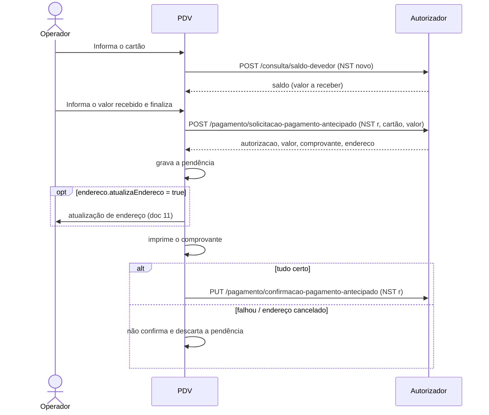

# 10 - Recebimento antecipado

## Objetivo

Receber do portador um valor **antes do fechamento da fatura** (adiantamento
do que ele deve). Diferente do [recebimento de fatura](09-recebimento-fatura.md),
a identificação é feita pelo **cartão**, não pela NSU de uma fatura.

## Endpoints

| Etapa | Método | Endpoint | Corpo | Resposta |
| --- | --- | --- | --- | --- |
| Saldo devedor (opcional, para mostrar quanto ele deve) | POST | `/consulta/saldo-devedor` | `ConsultaSaldoModel` | `SaldoDevedorModel` |
| Solicitação | POST | `/pagamento/solicitacao-pagamento-antecipado` | `SolicitacaoPagamentoAntecipadoModel` | `PagamentoFaturaAntecipadaModel` |
| Confirmação | PUT | `/pagamento/confirmacao-pagamento-antecipado` | `ConfirmacaoPagamentoAntecipadoModel` | 200 sem corpo |

Não existe endpoint de desfazimento de pagamento (ver [doc 05](05-confirmacao-desfazimento-e-pendencias.md)).

## Fluxo



## Saldo devedor

Veja o [doc 07](07-consulta-saldo.md#resposta-de-consultasaldo-devedor). O
exemplo mostra o saldo devedor em "Valor receber" e começa "Valor recebido"
em 0,00 para o operador digitar.

## Solicitação

**SolicitacaoPagamentoAntecipadoModel**

| Campo | Tipo | Obrigatório | Descrição | Exemplo |
| --- | --- | --- | --- | --- |
| `nst` | integer (int64) | sim | Número sequencial da transação Este número deve permanecer o mesmo durante todo o processamento da operação em tratamento, mesmo que envolva mais de um fluxo de mensagens (fluxos com continuação). (mín. 1, máx. 9999999999) | `1239` |
| `nomeSoftware` | string | sim | Nome do Software | `Card Aut App` |
| `versaoSoftware` | string | sim | Versão Software | `1.205.790` |
| `identificadorLoja` | string | sim | Identificação da loja | `01c760b2-a9db-429c-ad60-d926f49878cd` |
| `cartao` | string | sim | Número do cartão | `1111111111111111111` |
| `valor` | number | sim | Valor do pagamento (mín. 0.01) | `1.5` |

```json
{
  "nst": 1700,
  "nomeSoftware": "PDV Convcard Exemplo",
  "versaoSoftware": "1.0.0",
  "identificadorLoja": "01c760b2-a9db-429c-ad60-d926f49878cd",
  "cartao": "1111111111111111111",
  "valor": 100
}
```

## Resposta

**PagamentoFaturaAntecipadaModel**

| Campo | Tipo | Obrigatório | Descrição | Exemplo |
| --- | --- | --- | --- | --- |
| `cartao` | string | não | Número do Cartão Mascarado | `11XXXXXXXXXXXX11111` |
| `usuario` | string | não | Nome do Usuário | `USUARIO TESTE` |
| `saldo` | number | não | Saldo do Usuário | `459.55` |
| `valor` | number | não | Valor do Movimento | `1.5` |
| `autorizacao` | integer (int32) | não | Número da autorização | `123` |
| `endereco` | EnderecoModel | não | Endereço |  |
| `comprovante` | string | não | Comprovante a ser impresso, separado por '@' O retorno desta informação deve ser solicitado a Convcard | `EXEMPLO COMPROVANTE         @CREDENCIADA EXEMPLO  @Cartao Nu...` |

**EnderecoModel**

| Campo | Tipo | Obrigatório | Descrição | Exemplo |
| --- | --- | --- | --- | --- |
| `atualizaEndereco` | boolean | não | Indica se o endereço deve ser atualizado | `true` |
| `cep` | string | não | Número do CEP | `88704001` |
| `endereco` | string | não | Endereço | `Rua das Flores` |
| `complemento` | string | não | Complemento do endereço | `Apartamento 101` |
| `numero` | string | não | Número do endereço | `123` |
| `bairro` | string | não | Bairro | `Centro` |
| `cidade` | string | não | Cidade | `Florianópolis` |
| `estado` | string | não | Estado | `SC` |

```json
{
  "cartao": "11XXXXXXXXXXXX11111",
  "usuario": "USUARIO TESTE",
  "saldo": 559.55,
  "valor": 100,
  "autorizacao": 777,
  "endereco": { "atualizaEndereco": false },
  "comprovante": "..."
}
```

## Confirmação

**ConfirmacaoPagamentoAntecipadoModel**

| Campo | Tipo | Obrigatório | Descrição | Exemplo |
| --- | --- | --- | --- | --- |
| `nst` | integer (int64) | sim | Número sequencial da transação Este número deve permanecer o mesmo durante todo o processamento da operação em tratamento, mesmo que envolva mais de um fluxo de mensagens (fluxos com continuação). (mín. 1, máx. 9999999999) | `1239` |
| `nomeSoftware` | string | sim | Nome do Software | `Card Aut App` |
| `versaoSoftware` | string | sim | Versão Software | `1.205.790` |
| `identificadorLoja` | string | sim | Identificação da loja | `01c760b2-a9db-429c-ad60-d926f49878cd` |
| `cartao` | string | sim | Número do cartão | `1111111111111111111` |
| `valor` | number | sim | Valor do pagamento (mín. 0.01) | `1.5` |
| `autorizacao` | integer (int32) | sim | Número da autorização | `123` |

```json
{
  "nst": 1700,
  "nomeSoftware": "PDV Convcard Exemplo",
  "versaoSoftware": "1.0.0",
  "identificadorLoja": "01c760b2-a9db-429c-ad60-d926f49878cd",
  "cartao": "1111111111111111111",
  "valor": 100,
  "autorizacao": 777
}
```

## Regras

- Identificação sempre pelo **cartão** (no exemplo, o filtro do modo antecipado fica fixo em "Cartão").
- Se o retorno pedir atualização de endereço, ela é feita com o cartão informado ([doc 11](11-atualizacao-endereco.md)); se o operador cancelar, o recebimento não é confirmado.
- Valor recebido obrigatório e não negativo (validação do exemplo).

## Exceções

| Situação | O que fazer |
| --- | --- |
| Cartão inválido na consulta do saldo devedor | Mostre `message`; limpe os campos |
| Solicitação recusada | Mostre `message` |
| Atualização de endereço cancelada | Não confirme |
| Falha na impressão / lançamento | Não confirme (não há desfazimento) |
| Erro na confirmação | Mantenha a pendência e tente de novo |

## No exemplo

| O quê | Onde |
| --- | --- |
| Modo "Recebimento antecipado [F4]" da tela Recebimento | `src/angular/app/telas/recebimento/` |
| Chamadas e pendência | `consultarSaldoDevedor()` e `solicitarRecebimentoAntecipado()` em `src/electron/convcard/servico.ts` |
