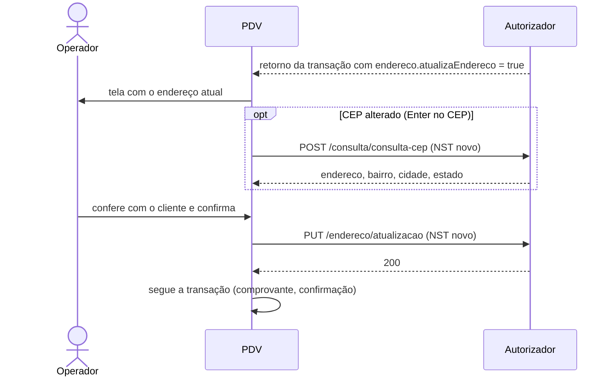

# 11 - Atualização de endereço e consulta de CEP

## Objetivo

Manter atualizado o endereço postal do portador. A Convcard pede a
atualização devolvendo `endereco.atualizaEndereco = true` no retorno de uma
transação; o PDV confirma os dados com o cliente e envia o endereço novo.

## Quando acontece

O campo `endereco` (`EnderecoModel`) vem nos retornos de:

| Retorno | Processo |
| --- | --- |
| `RetornoMovimentoModel` | [Compra com cartão](03-compra-cartao.md) |
| `PagamentoFaturaAntecipadaModel` | [Recebimento antecipado](10-recebimento-antecipado.md) |
| `PagamentoFaturaModel` | [Recebimento de fatura](09-recebimento-fatura.md) (o exemplo não pede a atualização aqui porque o PDV não informa cartão nesse fluxo) |

Na compra por QR Code o PDV não tem o número do cartão, então o exemplo não
pede a atualização.

**EnderecoModel**

| Campo | Tipo | Obrigatório | Descrição | Exemplo |
| --- | --- | --- | --- | --- |
| `atualizaEndereco` | boolean | não | Indica se o endereço deve ser atualizado | `true` |
| `cep` | string | não | Número do CEP | `88704001` |
| `endereco` | string | não | Endereço | `Rua das Flores` |
| `complemento` | string | não | Complemento do endereço | `Apartamento 101` |
| `numero` | string | não | Número do endereço | `123` |
| `bairro` | string | não | Bairro | `Centro` |
| `cidade` | string | não | Cidade | `Florianópolis` |
| `estado` | string | não | Estado | `SC` |

Os campos de endereço já vêm com o endereço atual cadastrado, para o operador
só conferir e corrigir.

## Endpoints

| Etapa | Método | Endpoint | Corpo | Resposta |
| --- | --- | --- | --- | --- |
| Consultar CEP (opcional, para preencher o endereço) | POST | `/consulta/consulta-cep` | `ConsultaCepModel` | `CepModel` |
| Atualizar endereço | PUT | `/endereco/atualizacao` | `AtualizacaoEnderecoModel` | 200 sem corpo |

## Fluxo



Se o operador **sair sem confirmar**, a transação que pediu a atualização é
desfeita (compra) ou não é confirmada (recebimento antecipado). É assim que o
exemplo faz; ajuste à sua regra de negócio se necessário.

## Consulta de CEP

### Requisição

**ConsultaCepModel**

| Campo | Tipo | Obrigatório | Descrição | Exemplo |
| --- | --- | --- | --- | --- |
| `nst` | integer (int64) | sim | Número sequencial da transação Este número deve permanecer o mesmo durante todo o processamento da operação em tratamento, mesmo que envolva mais de um fluxo de mensagens (fluxos com continuação). (mín. 1, máx. 9999999999) | `1239` |
| `nomeSoftware` | string | sim | Nome do Software | `Card Aut App` |
| `versaoSoftware` | string | sim | Versão Software | `1.205.790` |
| `identificadorLoja` | string | sim | Identificação da loja | `01c760b2-a9db-429c-ad60-d926f49878cd` |
| `cep` | integer (int32) | sim | Número do CEP | `88704001` |

```json
{
  "nst": 1800,
  "nomeSoftware": "PDV Convcard Exemplo",
  "versaoSoftware": "1.0.0",
  "identificadorLoja": "01c760b2-a9db-429c-ad60-d926f49878cd",
  "cep": 88704001
}
```

> `cep` é **numérico** (só dígitos, sem hífen).

### Resposta

**CepModel**

| Campo | Tipo | Obrigatório | Descrição | Exemplo |
| --- | --- | --- | --- | --- |
| `cep` | string | não | Número do CEP | `88704-001` |
| `endereco` | string | não | Endereço | `RUA DAS FLORES` |
| `bairro` | string | não | Bairro | `CENTRO` |
| `cidade` | string | não | Cidade | `FLORIANÓPOLIS` |
| `estado` | string | não | Estado | `SC` |

O exemplo preenche apenas os campos que vierem preenchidos e só consulta
quando o CEP tem 8 dígitos e é diferente do último consultado.

## Atualização de endereço

**AtualizacaoEnderecoModel**

| Campo | Tipo | Obrigatório | Descrição | Exemplo |
| --- | --- | --- | --- | --- |
| `nst` | integer (int64) | sim | Número sequencial da transação Este número deve permanecer o mesmo durante todo o processamento da operação em tratamento, mesmo que envolva mais de um fluxo de mensagens (fluxos com continuação). (mín. 1, máx. 9999999999) | `1239` |
| `nomeSoftware` | string | sim | Nome do Software | `Card Aut App` |
| `versaoSoftware` | string | sim | Versão Software | `1.205.790` |
| `identificadorLoja` | string | sim | Identificação da loja | `01c760b2-a9db-429c-ad60-d926f49878cd` |
| `cartao` | string | sim | Número do cartão | `1111111111111111111` |
| `cep` | integer (int32) | sim | Número do CEP | `88704001` |
| `endereco` | string | sim | Endereço | `Rua das Flores` |
| `complemento` | string | não | Complemento do endereço | `Apartamento 101` |
| `numero` | string | sim | Número do endereço | `123` |
| `bairro` | string | sim | Bairro | `Centro` |
| `cidade` | string | sim | Cidade | `Florianópolis` |
| `estado` | string | sim | Estado | `SC` |

```json
{
  "nst": 1801,
  "nomeSoftware": "PDV Convcard Exemplo",
  "versaoSoftware": "1.0.0",
  "identificadorLoja": "01c760b2-a9db-429c-ad60-d926f49878cd",
  "cartao": "1111111111111111111",
  "cep": 88704001,
  "endereco": "RUA DAS FLORES",
  "complemento": "APTO 101",
  "numero": "123",
  "bairro": "CENTRO",
  "cidade": "TUBARAO",
  "estado": "SC"
}
```

- `cartao`: o mesmo cartão da transação que pediu a atualização.
- `cep`: numérico.
- `complemento` é o único campo de endereço opcional.

## Exceções

| Situação | O que fazer |
| --- | --- |
| CEP com menos de 8 dígitos | Validação local ("CEP: Inválido") |
| CEP não encontrado | Mostre `message`; o operador preenche manualmente |
| Campo obrigatório vazio | Validação local, antes de enviar |
| Erro ao atualizar | Mostre `message`; a tela continua aberta para nova tentativa |
| Operador sai sem confirmar | Transação de origem desfeita/não confirmada ("Atualização de endereço cancelada") |

## No exemplo

| O quê | Onde |
| --- | --- |
| Tela "Atualização de endereço" (Enter/lupa consulta o CEP, F2 confirma, Esc cancela) | `src/angular/app/telas/endereco/` |
| Quando abrir e o que fazer se for cancelada | `finalizar()` em `src/angular/app/core/transacao.service.ts` |
| Chamadas | `consultarCep()` e `atualizarEndereco()` em `src/electron/convcard/servico.ts` |
