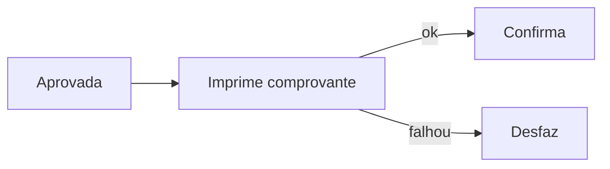

# 13 - Comprovantes e reimpressão

## O campo `comprovante`

Os retornos de compra, cancelamento, recebimento e consulta de saldo podem
trazer o campo `comprovante`: o texto pronto para impressão, com as **linhas
separadas por `@`**.

```
EXEMPLO COMPROVANTE         @CREDENCIADA EXEMPLO  @Cartao Numero: 11xxxxxxxxxxxx11111@Empresa: EXEMPLO                      @Saldo: 1080,07         NSU: 12312312@Autor. Usuario: TESTE@Mes/Ano Refer.: 12/2016@Data/Hora: 14/12/2016 10:26:49@Valor: 1,50@Numero de Parcelas: 1@@
```

Separando por `@`, cada pedaço é uma linha. `@@` no final gera linhas em branco.

```ts
const linhas = comprovante.split('@'); // uma string por linha
```

> Segundo o swagger: *"O retorno desta informação deve ser solicitado a
> Convcard"*. Se o seu cadastro não estiver habilitado, o campo pode vir
> vazio. Nesse caso, monte o seu próprio comprovante com os dados do retorno
> (`autorizacao`, `nsu`, `data`, `valor`, `cartao`...).

| Retorno | Modelo | Tem `comprovante` |
| --- | --- | --- |
| Compra (cartão e QR Code) | `RetornoMovimentoModel` | sim |
| Cancelamento | `RetornoMovimentoModel` | sim |
| Recebimento de fatura | `PagamentoFaturaModel` | sim |
| Recebimento antecipado | `PagamentoFaturaAntecipadaModel` | sim |
| Consulta de saldo | `SaldoModel` | sim |

## Impressão no fluxo da transação

A impressão acontece **depois da aprovação e antes da confirmação**. Se a
impressão falhar, a transação deve ser **desfeita**
([doc 05](05-confirmacao-desfazimento-e-pendencias.md)).



Dicas para o PDV real:

- Use fonte monoespaçada: o comprovante é alinhado por espaços.
- Defina quantas vias imprimir (cliente e estabelecimento) conforme a sua regra.
- Imprima também `mensagemLoja` na tela do operador quando vier preenchida (é uma mensagem para a loja, não para o comprovante).

O exemplo **simula** a impressora: mostra o comprovante e deixa o operador
escolher "Impresso [F2]" (confirma) ou "Falha na impressão [F3]" (desfaz),
para demonstrar os dois caminhos.

## Reimpressão do último movimento

A reimpressão **não chama o autorizador**: o PDV guarda o comprovante recebido
e imprime de novo quando pedido.

O exemplo guarda o comprovante da última transação **confirmada** de cada tipo:

| Tipo | Transações |
| --- | --- |
| `VENDA` | Compra com cartão e com QR Code |
| `CANCELAMENTO` | Cancelamento com cartão e com QR Code |
| `RECEBIMENTO` | Recebimento de fatura e antecipado |

Tabela SQLite `ultima_transacao` (`src/electron/armazenamento.ts`):

```sql
CREATE TABLE ultima_transacao (
  tipo        TEXT PRIMARY KEY, -- VENDA, CANCELAMENTO ou RECEBIMENTO
  data        TEXT NOT NULL,
  comprovante TEXT
);
```

O comprovante entra nessa tabela no momento em que a confirmação é aceita
(`finalizarPendente` em `src/electron/convcard/servico.ts`). Transações
desfeitas não substituem a última reimpressão.

Mensagens da tela de reimpressão:

| Situação | Mensagem |
| --- | --- |
| Nenhuma transação daquele tipo | "Nenhuma transação disponível para reimpressão." |
| Transação sem comprovante | "Última transação não possui comprovante para reimpressão." |

## No exemplo

| O quê | Onde |
| --- | --- |
| Impressora simulada | `src/angular/app/dialogos/impressora.component.ts` |
| Tela "Reimpressão" (Funções → F4) | `src/angular/app/telas/reimpressao/` |
| Gravação/leitura do último comprovante | `salvarUltimaTransacao()` / `obterUltimaTransacao()` em `src/electron/armazenamento.ts` |
