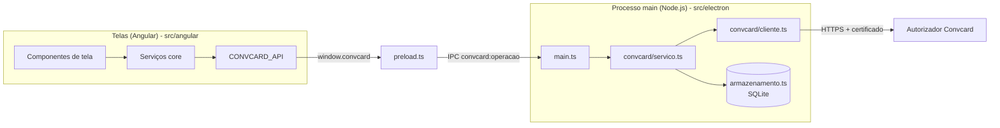

# 15 - PDV de exemplo (referência do código)

O repositório traz um PDV mínimo que implementa todos os processos desta
documentação. Use-o como referência; as regras de negócio do seu PDV (caixa,
estoque, fiscal) ficam de fora de propósito.

## Como rodar

```bash
npm install
npm start          # modo desenvolvimento
npm run typecheck  # checa Electron (tsc) e Angular, incluindo os templates (ngc)
npm run package    # gera o executável em out/
```

Na primeira execução abre a tela de **Configurações**: informe o token da
loja, o certificado (`.crt`) e a chave privada (`.key`) de homologação, e use
**Validar configuração [F3]**.

## Tecnologias

| Camada | Tecnologia |
| --- | --- |
| Aplicação desktop | Electron 45 + Electron Forge 8 |
| Build | Vite 8 (main, preload e telas) |
| Telas | Angular 22 (componentes standalone, signals, sem zone.js) + `@angular/cdk/dialog` para as modais |
| Compilação do Angular no Vite | `@analogjs/vite-plugin-angular` |
| Ícones | Lucide (empacotado no app) |
| Banco local | SQLite via `node:sqlite` (embutido no Node do Electron) |
| HTTP com certificado | `node:https` (`cert` + `key` em PEM) |

## Arquitetura



A integração roda no **processo main** (Node.js): é lá que ficam o
certificado, a senha, o banco e o acesso à rede. As telas só chamam funções
expostas pelo preload. Isso evita expor o certificado na camada web.

### Pastas

```
src/
  electron/                 Processo main (Node.js)
    main.ts                 janela, handlers IPC, emissão do PDF da fatura
    preload.ts              expõe window.convcard (uma função por operação)
    armazenamento.ts        SQLite: configuração, NST, pendência, últimos comprovantes
    convcard/
      cliente.ts            HTTP com mTLS, leitura JSON/binária, erros, máscara de log
      servico.ts            uma função por endpoint; NST; pendências; confirmação/desfazimento

  shared/                   Usado pelos dois lados
    ipc.ts                  contrato ConvcardApi + lista de operações do IPC
    modelos.ts              modelos da API (mesmos nomes do swagger)

  angular/                  Telas
    index.html, main.ts, styles.css
    public/imagens          logos da marca
    assets/fontes           fonte Funnel Display
    app/
      app.component.*       tela principal (topo, atalhos F5 e Ctrl+U)
      app.config.ts         providers (zoneless, pt-BR, carga da configuração)
      core/                 serviços sem tela
      componentes/          moldura das telas, ícones, visor, máscaras
      dialogos/             Mensagem Operador, Atenção, Confirmação, Aguarde, Impressora
      telas/                uma pasta por tela (controlador .ts + view .html)
      pdv/                  venda e painel de log
```

## Onde está cada processo

| Processo | Tela (Angular) | Serviço (main) |
| --- | --- | --- |
| Configuração e validação | `telas/configuracao` | `validarConfiguracao` |
| Compra com cartão | `telas/venda-cartao` + `pdv/venda.component.ts` | `solicitarCompra` |
| Compra com QR Code | `telas/qrcode` | `gerarQrCode`, `solicitarCompraQrCode` |
| Confirmação/desfazimento | `core/transacao.service.ts` | `confirmarPendente`, `desfazerPendente` |
| Cancelamento | `telas/cancelamento`, `excluirVenda()` em `pdv/venda.component.ts` | `solicitarCancelamento` |
| Consulta de saldo | `telas/consulta-saldo` | `consultarSaldo`, `consultarSaldoDevedor` |
| Fatura e PDF | `telas/emissao-fatura` | `consultarFatura`, `baixarFaturaPdf` (+ `emitirFatura` no main.ts) |
| Recebimentos | `telas/recebimento` | `solicitarRecebimento`, `solicitarRecebimentoAntecipado` |
| Endereço e CEP | `telas/endereco` | `consultarCep`, `atualizarEndereco` |
| Token | `telas/token` | `cadastrarToken` |
| Reimpressão | `telas/reimpressao` | `obterUltimaTransacao` |

Caminhos das telas relativos a `src/angular/app/`; serviços em `src/electron/convcard/servico.ts`.

## Padrões usados nas telas

### Chamar a API

```ts
private readonly api = inject(CONVCARD_API);

const saldo = await this.api.consultarSaldo(cartao); // rejeita com ErroConvcard em caso de erro
```

`CONVCARD_API` é um token de injeção (`src/angular/app/core/convcard-api.ts`).
Nos testes, troque por um mock:

```ts
providers: [{ provide: CONVCARD_API, useValue: mockApi }]
```

### Abrir uma modal e receber o resultado

```ts
const resultado = await this.dialogos.abrir(VendaCartaoComponent, dadosCompra);
```

- `DialogosService.abrir` usa `@angular/cdk/dialog` e devolve o valor passado em `fechar(resultado)`.
- Cada tela estende `TelaBase`, que declara os atalhos (`teclas = { F2: () => this.enviar() }`) e o comportamento do Esc (`aoEsc`).
- O CDK entrega as teclas só para a modal do topo.

### Controlador × view

Cada tela tem o controlador em `.ts` (estado em `signal`/`computed` e ações)
e a view em `.html`. A view não chama a API diretamente: chama métodos do
controlador.

### Máscaras

A diretiva `appMascara` (`componentes/mascara.directive.ts`) funciona com
`[(ngModel)]` e entrega o valor limpo ao controlador:

```html
<input appMascara="cartao" [(ngModel)]="cartao" />  <!-- cartao() === '1111111111111111111' -->
<input appMascara="valor" [(ngModel)]="valor" />    <!-- valor() === 38.15 -->
```

Tipos: `cartao`, `cpf`, `cep`, `numero` (com `[tamanho]`), `valor`, `maiusculas` (com `[tamanho]`).

## Banco SQLite

Arquivo `pdv-convcard.db` na pasta de dados do app (Windows:
`%APPDATA%\PDV Convcard Exemplo`).

| Tabela | Conteúdo |
| --- | --- |
| `configuracao` | Token da loja, caminhos do `.crt` e da `.key`, flags de receita/nota, nome e versão do software |
| `sequencia_nst` | Último NST (incremento atômico com `INSERT ... ON CONFLICT ... RETURNING`) |
| `transacao_pendente` | Transação aprovada aguardando confirmação/desfazimento (no máximo uma). Único lugar com cartão/QR Code: registro inteiro criptografado (safeStorage/DPAPI) e apagado após o uso |
| `ultima_transacao` | Último comprovante confirmado de cada tipo (reimpressão) |

## Como adaptar ao seu PDV

| No exemplo | No seu PDV |
| --- | --- |
| Catálogo fixo de produtos (`CATALOGO` em `pdv/venda.component.ts`) | Seus produtos, com os descontos reais e o tipo (`O` para itens comuns; E/G/S/M só para medicamentos) |
| Impressora simulada (`dialogos/impressora.component.ts`) | Impressão real (ECF / não fiscal), com tratamento de falha |
| Venda registrada só em memória | Gravação da venda, emissão fiscal, baixa de estoque, antes da confirmação |
| Recebimento sem caixa | Abertura de caixa, lançamento do recebimento e das formas de pagamento antes da confirmação |
| `.key` em qualquer pasta escolhida pelo operador | `.key` em pasta com acesso restrito |
| Somente homologação | Produção configurável depois da homologação aprovada |
